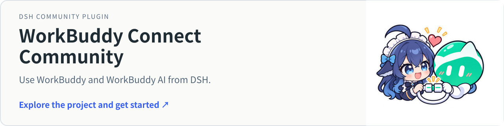
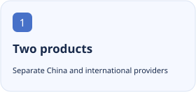
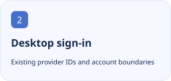
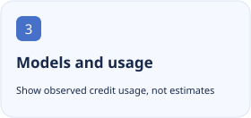

<p align="center"></p>

<h1 align="center">WorkBuddy Connect Community</h1>

<p align="center">Reuse WorkBuddy or WorkBuddy AI desktop sign-in inside DSH, including product-specific models, context choices and observed usage.</p>

<p align="center"><a href="https://github.com/tangyixiao/dsh-workbuddy-connect-community"></a></p>

<p align="center"><a href="README.md">简体中文</a> · <a href="README.en.md">English</a></p>

[](https://github.com/tangyixiao/dsh-workbuddy-connect-community/stargazers) [](https://github.com/tangyixiao/dsh-workbuddy-connect-community/actions/workflows/check.yml) [](LICENSE) [](https://www.npmjs.com/package/dsh-workbuddy-connect-community)


Historical upstream screenshot of the model menu; current models, prices and plans come from the actual client.

<p align="center">
  <picture><source media="(prefers-color-scheme: dark)" srcset="docs/assets/feature-1-en-dark.svg"></picture>
  <picture><source media="(prefers-color-scheme: dark)" srcset="docs/assets/feature-2-en-dark.svg"></picture>
  <picture><source media="(prefers-color-scheme: dark)" srcset="docs/assets/feature-3-en-dark.svg"></picture>
</p>

## Get started

Desktop: install the release `.tgz` through Extensions → Plugin Management → Add Plugin. For a Web profile you explicitly control:

```sh
dsh plugin --profile web add dsh-workbuddy-connect-community@0.1.16
```

Sign in to the matching desktop product. Disable the original `dsh-workbuddy-connect` before enabling this community package; they share provider IDs. Use `dsh-workbuddy-connect-community doctor --share` for a redacted diagnostic.

## Status and compatibility

| Item | Current source of truth |
| --- | --- |
| Source version | `0.1.16` · 以 [package.json](package.json) 为准 |
| Distribution | `npm` · [Releases](https://github.com/tangyixiao/dsh-workbuddy-connect-community/releases) |
| DSH | `0.2.1-rc.2 \|\| 0.2.1-rc.3 \|\| 0.2.1-rc.5 \|\| 0.2.2-rc.1` |
| Node.js | `^22.19.0 \|\| >=24.0.0` |
| Development | [Open issues](https://github.com/tangyixiao/dsh-workbuddy-connect-community/issues?q=is%3Aissue+is%3Aopen) · [CI](https://github.com/tangyixiao/dsh-workbuddy-connect-community/actions) |

Observed `usage.credit` is neither a token-price estimate nor a session total. Validate catalogs, local sign-in and live upstream requests separately.

[Detailed usage, configuration and troubleshooting](docs/guide.en.md)

## Development and participation

```sh
pnpm install --frozen-lockfile
pnpm run check
node tools/check-repository.mjs
```

[Contributing](CONTRIBUTING.md) · [Support](SUPPORT.md) · [Questions](https://github.com/tangyixiao/dsh-workbuddy-connect-community/discussions) · [Report a bug](https://github.com/tangyixiao/dsh-workbuddy-connect-community/issues/new/choose) · [Security](SECURITY.md) · [Maintenance](docs/maintenance.md)

## Star History

<picture><source media="(prefers-color-scheme: dark)" srcset="https://api.star-history.com/chart?repos=tangyixiao/dsh-workbuddy-connect-community&amp;type=date&amp;theme=dark&amp;legend=top-left"></picture>

[Interactive chart](https://www.star-history.com/?repos=tangyixiao%2Fdsh-workbuddy-connect-community&type=date) · [GitHub Stars](https://github.com/tangyixiao/dsh-workbuddy-connect-community/stargazers)

The external chart uses real star records and may be cached or unavailable; no development percentage is inferred.

## Origin and licenses

[Software license](LICENSE) · [Logo artwork and attribution](assets/NOTICE.md)

Software retains its existing license. Whale-girl derivative artwork is separately CC BY-NC-SA 4.0 with the attribution chain for 上善, ZipZipPipe and Small-tailqwq.

Based on [Corrine Hu’s dsh-workbuddy-connect](https://github.com/corrinehu/dsh-workbuddy-connect); original MIT notices remain in [THIRD_PARTY_NOTICES.txt](THIRD_PARTY_NOTICES.txt).
