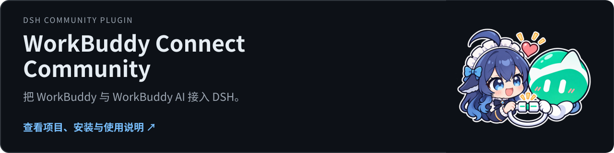
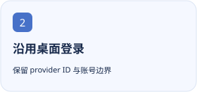

<p align="center"></p>

<h1 align="center">WorkBuddy Connect Community</h1>

<p align="center">在 DSH 中沿用 WorkBuddy / WorkBuddy AI 桌面登录，接入两个产品的模型、上下文选项与可观测用量。</p>

<p align="center"><a href="https://github.com/tangyixiao/dsh-workbuddy-connect-community"></a></p>

<p align="center"><a href="README.md">简体中文</a> · <a href="README.en.md">English</a></p>

[](https://github.com/tangyixiao/dsh-workbuddy-connect-community/stargazers) [](https://github.com/tangyixiao/dsh-workbuddy-connect-community/actions/workflows/check.yml) [](LICENSE) [](https://www.npmjs.com/package/dsh-workbuddy-connect-community)


上游历史版本的功能位置截图；模型、价格与套餐以当前客户端为准。

<p align="center">
  <picture><source media="(prefers-color-scheme: dark)" srcset="docs/assets/feature-1-zh-CN-dark.svg"></picture>
  <picture><source media="(prefers-color-scheme: dark)" srcset="docs/assets/feature-2-zh-CN-dark.svg"></picture>
  <picture><source media="(prefers-color-scheme: dark)" srcset="docs/assets/feature-3-zh-CN-dark.svg"></picture>
</p>

## 开始使用

Desktop：从发行页下载 `.tgz`，在“扩展 → 插件管理 → 添加插件”中安装。命令行示例用于你明确控制的 Web profile：

```sh
dsh plugin --profile web add dsh-workbuddy-connect-community@0.1.16-rc5.3
```

先登录对应桌面客户端。安装社区包后，先停用原 `dsh-workbuddy-connect` 再启用社区包；两者使用相同 provider ID。CLI 诊断用 `dsh-workbuddy-connect-community doctor --share`。

## 当前状态与兼容性

| 项目 | 当前依据 |
| --- | --- |
| 源码版本 | `0.1.16-rc5.3` · 以 [package.json](package.json) 为准 |
| 分发方式 | `npm` · [Releases](https://github.com/tangyixiao/dsh-workbuddy-connect-community/releases) |
| DSH | `0.2.1-rc.2 \|\| 0.2.1-rc.3 \|\| 0.2.1-rc.5 \|\| 0.2.2-rc.1` |
| Node.js | `^22.19.0 \|\| >=24.0.0` |
| 开发状态 | [Open issues](https://github.com/tangyixiao/dsh-workbuddy-connect-community/issues?q=is%3Aissue+is%3Aopen) · [CI](https://github.com/tangyixiao/dsh-workbuddy-connect-community/actions) |

已观察到的 `usage.credit` 不等于按 token 估算价格，也不代表整段会话总费用。模型目录、登录状态与真实上游请求须分别验证。

[详细使用、配置与故障排查](docs/guide.zh-CN.md)

## 开发与参与

```sh
pnpm install --frozen-lockfile
pnpm run check
node tools/check-repository.mjs
```

[Contributing](CONTRIBUTING.md) · [Support](SUPPORT.md) · [Questions](https://github.com/tangyixiao/dsh-workbuddy-connect-community/discussions) · [Report a bug](https://github.com/tangyixiao/dsh-workbuddy-connect-community/issues/new/choose) · [Security](SECURITY.md) · [Maintenance](docs/maintenance.md)

## Star History

<picture><source media="(prefers-color-scheme: dark)" srcset="https://api.star-history.com/chart?repos=tangyixiao/dsh-workbuddy-connect-community&amp;type=date&amp;theme=dark&amp;legend=top-left"></picture>

[Interactive chart](https://www.star-history.com/?repos=tangyixiao%2Fdsh-workbuddy-connect-community&type=date) · [GitHub Stars](https://github.com/tangyixiao/dsh-workbuddy-connect-community/stargazers)

图表由外部服务按真实星标数据生成，可能缓存或暂时不可用；未填造开发百分比。

## 来源与许可

[Software license](LICENSE) · [Logo artwork and attribution](assets/NOTICE.md)

软件保持原许可证；鲸鱼娘衍生美术单独采用 CC BY-NC-SA 4.0，并保留上善、ZipZipPipe、Small-tailqwq 的署名链。

Based on [Corrine Hu’s dsh-workbuddy-connect](https://github.com/corrinehu/dsh-workbuddy-connect); original MIT notices remain in [THIRD_PARTY_NOTICES.txt](THIRD_PARTY_NOTICES.txt).
